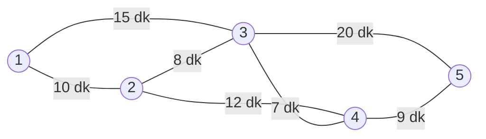
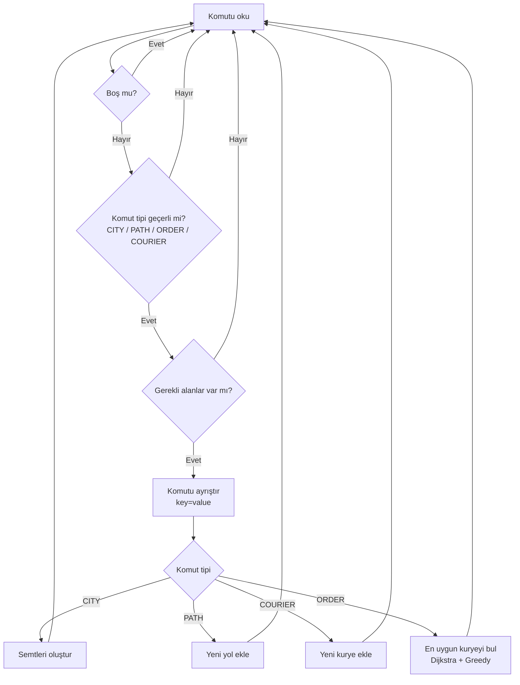

# 🛵 CourierDispatcher — Kurye Atama Sistemi

CourierDispatcher, bir şehirdeki **semtler (district)**, semtleri birbirine bağlayan **yollar (path)** ve bu semtlerde bekleyen **kuryeler (courier)** üzerinden çalışan bir **konsol uygulamasıdır**.

Yeni bir **sipariş (order)** geldiğinde program şu soruyu cevaplar:

> **"Boştaki kuryelerden hangisi restorana gidip siparişi alır ve müşteriye en kısa sürede teslim eder?"**

Bu soruyu cevaplamak için iki algoritma birlikte kullanılır:

1. **Dijkstra En Kısa Yol Algoritması:** İki semt arasındaki en kısa süreyi (dakika) bulur.
2. **Açgözlü (Greedy) Kurye Seçimi:** Her boş kurye için toplam teslimat süresini hesaplar ve en kısasını seçer.

---

## 📑 İçindekiler

- [Proje Yapısı](#-proje-yapısı)
- [Veri Modelleri](#-veri-modelleri)
- [Başlangıç Verileri (Örnek Şehir)](#-başlangıç-verileri-örnek-şehir)
- [Programın Genel Akışı](#-programın-genel-akışı)
- [Adım 1 — Komutu Okuma ve Doğrulama](#adım-1--komutu-okuma-ve-doğrulama)
- [Adım 2 — Komutu Ayrıştırma (Parsing)](#adım-2--komutu-ayrıştırma-parsing)
- [Adım 3 — Komutu Çalıştırma](#adım-3--komutu-çalıştırma)
- [Algoritma 1 — Dijkstra En Kısa Yol](#-algoritma-1--dijkstra-en-kısa-yol)
- [Algoritma 2 — En Uygun Kuryeyi Seçme](#-algoritma-2--en-uygun-kuryeyi-seçme)
- [Baştan Sona Örnek Senaryo](#-baştan-sona-örnek-senaryo)
- [Karmaşıklık Analizi](#-karmaşıklık-analizi)
- [Komut Referansı](#-komut-referansı)
- [Çalıştırma](#-çalıştırma)
- [Geliştirme Notları](#-geliştirme-notları)

---

## 📁 Proje Yapısı

```
CourierDispatcher/
├── Program.cs                          # Ana döngü, komut işleme ve algoritmalar
├── Enums/
│   └── CommandType.cs                  # Geçerli komut isimleri (CITY, PATH, ORDER, COURIER)
├── Models/
│   ├── Courier.cs                      # Kurye modeli
│   ├── District.cs                     # Semt modeli
│   ├── Order.cs                        # Sipariş modeli
│   └── Path.cs                         # İki semt arasındaki yol modeli
└── Services/
    ├── Abstraction/
    │   └── ICommandTypeService.cs      # Komut doğrulama arayüzü
    └── Implementation/
        └── CommandTypeService.cs       # Komut doğrulama işlemleri
```

---

## 🧱 Veri Modelleri

Algoritmayı anlamak için önce verinin nasıl tutulduğunu bilmek gerekir.

| Model | Alanlar | Açıklama |
|---|---|---|
| `District` | `No` | Şehirdeki bir semt. Graf teorisindeki **düğüm (node / vertex)** karşılığıdır. |
| `Path` | `A`, `B`, `Minute` | `A` ve `B` semtleri arasındaki yol ve bu yolun kaç dakika sürdüğü. Graftaki **ağırlıklı kenar (weighted edge)** karşılığıdır. Yollar **çift yönlüdür**: A→B ile B→A aynı süreyi alır. |
| `Courier` | `No`, `DistrictId`, `Status` | Kurye numarası, bulunduğu semt ve müsaitlik durumu. `Status = true` kuryenin **boşta** olduğunu, `false` ise **meşgul** olduğunu gösterir. |
| `Order` | `Id`, `Time`, `Restaurant`, `Customer`, `Status` | Siparişin numarası (`S1`, `S2`, …), restoranın semti ve müşterinin semti. |

`CommandType` sınıfı, programın tanıdığı dört komutu sabit (`const`) olarak tutar:

```csharp
CITY  |  PATH  |  ORDER  |  COURIER
```

> 💡 **Graf nedir?** Düğümlerden ve bu düğümleri bağlayan kenarlardan oluşan yapıya graf denir. Bu projede **semtler düğüm**, **yollar kenar**, **dakikalar da kenar ağırlığıdır**. Harita uygulamalarındaki rota hesaplamaları da aynı fikre dayanır.

---

## 🗺️ Başlangıç Verileri (Örnek Şehir)

Program açıldığında hazır bir şehirle başlar: **5 semt, 7 yol ve 5 kurye**.

### Şehir Haritası



### Kuryeler

| Kurye No | Bulunduğu Semt | Durum |
|:---:|:---:|:---:|
| 1 | 1 | ✅ Boşta |
| 2 | 3 | ✅ Boşta |
| 3 | 5 | ✅ Boşta |
| 4 | 2 | ❌ Meşgul |
| 5 | 4 | ❌ Meşgul |

---

## 🔄 Programın Genel Akışı

Program, kullanıcıdan sürekli komut alan **sonsuz bir döngüdür** (`do { ... } while(true)`). Her turda şu adımlar sırayla çalışır:



---

### Adım 1 — Komutu Okuma ve Doğrulama

```csharp
string? raw = Console.ReadLine();
string[] rawArray = raw.Trim().Split(" ");
string commandType = rawArray[0];
```

Kullanıcının yazdığı satır boşluklardan bölünür. **İlk kelime komut tipidir**, geri kalanlar komutun parametreleridir.

```
ORDER time=10 restaurant=2 customer=5
└─┬─┘ └──┬──┘ └─────┬────┘ └────┬───┘
komut  parametre  parametre  parametre
```

Ardından `CommandTypeService` iki kontrol yapar:

1. **`IsValidType`:** Komut tipi `CITY`, `PATH`, `ORDER` veya `COURIER`'dan biri mi?
2. **`IsValidProperties`:** Komut, kendi tipine ait alan adlarından en az birini içeriyor mu? (Örneğin `ORDER` için `time`, `restaurant` veya `customer`.)

Kontrollerden biri geçmezse kullanıcıya hata mesajı ve doğru kullanım örnekleri gösterilir, döngü başa döner (`continue`).

> 💡 Doğrulama işlemi `ICommandTypeService` arayüzü arkasına alınmıştır. Böylece doğrulama kuralları değişse bile `Program.cs` dosyasına dokunmak gerekmez. Bu yaklaşıma **Soyutlama (Abstraction)** ve **Tek Sorumluluk İlkesi (Single Responsibility)** denir.

---

### Adım 2 — Komutu Ayrıştırma (Parsing)

Her parametre `=` işaretinden ikiye bölünür:

```csharp
var property = rawString.Split("=");   // "restaurant=2" → ["restaurant", "2"]
string fieldName  = property[0].ToLower();  // "restaurant"
string fieldValue = property[1];            // "2"
```

Sonra komut tipine göre bir `switch` ile ilgili nesnenin alanı doldurulur:

| Komut | Alan adı | Doldurulan alan |
|---|---|---|
| `CITY` | `numberofdistrict` | `numberOfDistricts` |
| `PATH` | `a`, `b`, `minute` | `path.A`, `path.B`, `path.Minute` |
| `ORDER` | `time`, `restaurant`, `customer` | `order.Time`, `order.Restaurant`, `order.Customer` |
| `COURIER` | `no`, `district` | `courier.No`, `courier.DistrictId` |

Sayıya çevirme işi `int.TryParse` ile yapılır. Değer sayı değilse program çökmez, alan `0` olur.

> 💡 Alan adları `ToLower()` ile küçük harfe çevrildiği için `Restaurant=2` ile `restaurant=2` aynı şekilde okunur. **Komut tipi ise büyük harfle yazılmalıdır** (`ORDER`, `order` değil).

---

### Adım 3 — Komutu Çalıştırma

| Komut | Ne yapar? |
|---|---|
| `CITY` | Verilen sayıya göre `districts` listesine semt ekler. |
| `PATH` | Her iki semtin de var olduğunu kontrol eder ve yolu `paths` listesine ekler. |
| `COURIER` | Kuryenin semtinin var olduğunu kontrol eder ve kuryeyi `couriers` listesine ekler. |
| `ORDER` | Projenin asıl işi burada yapılır. En uygun kuryeyi bulur ve siparişi ona atar. Ayrıntıları aşağıda. |

---

## 🧭 Algoritma 1 — Dijkstra En Kısa Yol

Kodda `FindShortestPath(startDistrict, targetDistrict)` adıyla geçer.

### Amaç

Bir başlangıç semtinden hedef semte gitmenin **en kısa süresini** bulmak.

### Neden Dijkstra?

- Yolların süreleri **farklıdır** (ağırlıklı graf). Bu yüzden en az durakla gitmek her zaman en hızlı yol değildir.
- Süreler **negatif olamaz**. Dijkstra tam olarak bu durum için tasarlanmıştır.

### Temel Fikir

> "Her zaman, şu ana kadar ulaşılması **en kısa sürecek** ve henüz kesinleşmemiş semti seç. O semtin komşularına bu semt üzerinden gitmek daha kısaysa, komşuların sürelerini güncelle."

### Kullanılan Veri Yapıları

```csharp
Dictionary<int, int> distances;  // semt → başlangıçtan bu semte bilinen en kısa süre
HashSet<int> visited;            // en kısa süresi kesinleşmiş semtler
```

### Adım Adım

**1. Başlangıç değerlerini ver**

```csharp
distances[district.No] = district.No == startDistrict ? 0 : int.MaxValue;
```

Başlangıç semtinin süresi `0`, diğer tüm semtlerin süresi **sonsuz** (`int.MaxValue`, yani "henüz yol bilinmiyor") olarak atanır.

**2. En yakın ziyaret edilmemiş semti seç**

```csharp
int currentDistrict = distances
    .Where(x => !visited.Contains(x.Key))
    .OrderBy(x => x.Value)
    .First().Key;
```

**3. Hedefe ulaşıldı mı?**

```csharp
if (currentDistrict == targetDistrict)
    return distances[currentDistrict];
```

Dijkstra'nın önemli bir özelliği vardır: Bir semt **seçildiği anda süresi kesinleşir**. Bu yüzden hedef seçildiğinde algoritma geri kalan semtlere bakmadan durur. Bu yönteme **erken çıkış (early exit)** denir.

**4. Ulaşılamayan semt kontrolü**

```csharp
if (distances[currentDistrict] == int.MaxValue)
    break;
```

Seçilen en yakın semt bile sonsuz uzaklıktaysa, kalan semtlerin hiçbirine yol yoktur. Döngü biter ve `int.MaxValue` döner, yani **yol yok** demektir.

**5. Semti ziyaret edildi olarak işaretle ve komşuları güncelle (Relaxation)**

```csharp
visited.Add(currentDistrict);

foreach (var path in connectedPaths)
{
    int neighborDistrict = path.A == currentDistrict ? path.B : path.A;  // yol çift yönlü
    if (visited.Contains(neighborDistrict)) continue;

    int newDistance = distances[currentDistrict] + path.Minute;
    if (newDistance < distances[neighborDistrict])
        distances[neighborDistrict] = newDistance;
}
```

Bu adıma **gevşetme (relaxation)** denir: *"Komşuya bu semtin üzerinden gitmek, bildiğim yoldan daha kısa mı? Öyleyse yeni süreyi kaydet."*

**6. 2. adıma dön.**

### 🔍 Örnek İzleme: 3. semtten 2. semte

Başlangıç: `{1: ∞, 2: ∞, 3: 0, 4: ∞, 5: ∞}`

| Tur | Seçilen semt | Yapılan işlem | `distances` sonrası |
|:---:|:---:|---|---|
| 1 | **3** (0) | Komşular: 1→0+15, 2→0+8, 4→0+7, 5→0+20 | `{1:15, 2:8, 3:0, 4:7, 5:20}` |
| 2 | **4** (7) | 2→7+12=19 (8'den büyük, değişmez), 5→7+9=**16** (20'den küçük, güncellenir) | `{1:15, 2:8, 3:0, 4:7, 5:16}` |
| 3 | **2** (8) | 🎯 Hedef seçildi, **8 döndürülür** | |

Sonuç: **3 → 2 = 8 dakika.**

Dikkat: 2. turda 5. semtin süresi 20'den 16'ya düştü. Doğrudan yol (3→5) 20 dakika sürüyor, ama 3→4→5 güzergâhı 7+9 = 16 dakika. Dijkstra'nın bulduğu şey tam olarak bu tür **dolaylı ama daha kısa** yollardır.

---

## 🏆 Algoritma 2 — En Uygun Kuryeyi Seçme

Bir `ORDER` komutu geldiğinde sırayla şunlar yapılır:

### 1. Boştaki kuryeleri filtrele

```csharp
List<Courier> availableCouriers = couriers.Where(x => x.Status).ToList();
```

Boş kurye yoksa sipariş iptal edilir: `Cancelled order: No available couriers.`

### 2. Restoran ve müşteri semtlerini doğrula

Bu semtlerden biri şehirde yoksa: `Order: Invalid restaurant or customer district.`

### 3. Her kurye için toplam süreyi hesapla

Bir kuryenin teslimat süresi **iki ayaktan** oluşur:

```
 Kurye ──(1. ayak)──▶ Restoran ──(2. ayak)──▶ Müşteri

 Toplam = EnKısaYol(Kurye, Restoran) + EnKısaYol(Restoran, Müşteri)
```

Bu hesabı `FindCourier` fonksiyonu yapar. İçeride Dijkstra'yı iki kez çağırır. İki ayaktan birine yol yoksa `-1` döner.

### 4. En küçük toplamı seç (Greedy)

```csharp
if (totalMinutes != -1 && totalMinutes < minimumMinutes)
{
    minimumMinutes = totalMinutes;
    selectedCourier = availableCourier;
}
```

Bu, klasik **minimum bulma** kalıbıdır. `minimumMinutes` en başta `int.MaxValue` ile başlar ve daha küçük bir değer bulundukça güncellenir.

> 💡 Karşılaştırmada `<` kullanıldığı için **eşitlik durumunda listede önce gelen kurye** seçilir.

> 💡 **Neden "açgözlü" (greedy)?** Algoritma sadece **şu anki** siparişi en hızlı teslim edecek kuryeyi seçer. Bu seçimin ileride gelecek siparişleri nasıl etkileyeceğini hesaba katmaz. Gerçek kurye sistemlerinde bu kararlar çoğu zaman daha geniş bir optimizasyonla verilir, ancak greedy yaklaşım basit, hızlı ve çoğu durumda yeterlidir.

### 5. Siparişi ata

```csharp
order.Id = $"S{orders.Count + 1}";   // S1, S2, S3...
orders.Add(order);
selectedCourier.Status = false;      // kurye artık meşgul
```

Seçilen kurye **meşgul** olarak işaretlenir ve sonraki siparişlerde hesaba katılmaz.

---

## 🎬 Baştan Sona Örnek Senaryo

Kullanıcı şu komutu giriyor:

```
ORDER time=10 restaurant=2 customer=5
```

Önce 2. ayak (restoran → müşteri) hesaplanır. Bu süre tüm kuryeler için aynıdır:

**2 → 5:** 2→4 (12) + 4→5 (9) = **21 dakika**

Sonra her boş kurye için 1. ayak (kurye → restoran) hesaplanır:

| Kurye | Semti | Kurye → Restoran (2) | Restoran → Müşteri (5) | **Toplam** |
|:---:|:---:|:---:|:---:|:---:|
| 1 | 1 | 1→2 = 10 | 21 | 31 |
| **2** | **3** | **3→2 = 8** | **21** | **29 ✅** |
| 3 | 5 | 5→4→2 = 9+12 = 21 | 21 | 42 |

Kurye 4 ve 5 meşgul olduğu için hesaba katılmaz.

**Çıktı:**

```
--------------------------------
Order Id: S1
Selected Courier: 2
Courier District: 3
Restaurant District: 2
Customer District: 5
Total Minutes: 29
--------------------------------
```

Aynı sipariş arka arkaya tekrar girilirse ne olur?

| Sipariş | Boştaki kuryeler | Seçilen | Süre |
|:---:|---|:---:|:---:|
| S1 | 1, 2, 3 | Kurye 2 | 29 dk |
| S2 | 1, 3 | Kurye 1 | 31 dk |
| S3 | 3 | Kurye 3 | 42 dk |
| — | *(yok)* | — | `Cancelled order: No available couriers.` |

---

## ⏱️ Karmaşıklık Analizi

Kısaltmalar: **V** = semt sayısı, **E** = yol sayısı, **C** = boştaki kurye sayısı.

| İşlem | Karmaşıklık | Açıklama |
|---|---|---|
| Dijkstra (bu projedeki hâli) | `O(V · (V log V + E))` | Her turda en yakın semti bulmak için tüm semtler sıralanır (`OrderBy`) ve komşu yollar için tüm yol listesi taranır (`paths.Where`). |
| Bir siparişin işlenmesi | `O(C · V · (V log V + E))` | Her kurye için Dijkstra 2 kez çalışır. |
| Bellek | `O(V)` | `distances` ve `visited` yapıları. |

Bu proje gibi **küçük şehirlerde** bu süreler önemsizdir. Şehir büyüdükçe şu iyileştirmeler yapılabilir:

- **Öncelik kuyruğu (`PriorityQueue<TElement, TPriority>`):** En yakın semti sıralamadan bulur. Dijkstra'yı `O((V + E) log V)` seviyesine indirir.
- **Komşuluk listesi (`Dictionary<int, List<Path>>`):** Her semtin komşularını tüm yol listesini taramadan doğrudan verir.
- **Ortak hesabı bir kez yapmak:** Restoran → müşteri süresi tüm kuryeler için aynıdır, döngüden önce bir kez hesaplanabilir.
- **Tek Dijkstra ile tüm kuryeler:** Yollar çift yönlü olduğu için **restorandan başlayan tek bir Dijkstra**, restoranın tüm kuryelere olan uzaklığını tek seferde verir.

---

## 📋 Komut Referansı

| Komut | Söz dizimi | Örnek |
|---|---|---|
| Şehir | `CITY numberOfDistrict=<sayı>` | `CITY numberOfDistrict=5` |
| Yol | `PATH a=<semt> b=<semt> minute=<dakika>` | `PATH a=1 b=2 minute=10` |
| Kurye | `COURIER no=<no> district=<semt>` | `COURIER no=6 district=2` |
| Sipariş | `ORDER time=<zaman> restaurant=<semt> customer=<semt>` | `ORDER time=10 restaurant=2 customer=5` |

**Kurallar:**

- Komut adı **BÜYÜK HARF** yazılmalıdır.
- Parametreler `anahtar=değer` biçiminde, aralarında **tek boşlukla** yazılmalıdır.
- `=` işaretinin iki yanında boşluk olmamalıdır.

---

## ▶️ Çalıştırma

**Gereksinimler:**

- .NET 6 veya üzeri (top-level statements ve implicit usings kullanılıyor)
- `Microsoft.Extensions.DependencyInjection` NuGet paketi

```bash
dotnet add package Microsoft.Extensions.DependencyInjection
dotnet run
```

Program açılınca `Enter, Command:` yazısı görünür ve komut beklemeye başlar.

---

## 📝 Geliştirme Notları

Koda dokunulmadan yapılan incelemede bazı davranışlar göze çarptı. Bunlar ileride geliştirme yaparken bakılabilecek noktalardır:

1. **PATH ve COURIER semt kontrolü:** `districts.Any(x => x.No != path.A)` ifadesi, listede A'dan **farklı herhangi bir** semt varsa `true` döner. Şehirde birden fazla semt olduğunda bu koşul hep sağlandığı için yeni yol ve kurye eklenemez. Amaçlanan kontrol muhtemelen `!districts.Any(x => x.No == path.A)` idi. Aynı durum `courier.DistrictId` kontrolü için de geçerli.
2. **CITY komutu:** Döngü `numberOfDistricts - 1` kez çalışıyor, yani bir eksik semt ekliyor. Ayrıca semtleri mevcut listenin üzerine ekliyor. Bu durumda aynı numaralı semtler oluşur ve Dijkstra'daki `distances.Add` aynı anahtarı iki kez eklemeye çalışınca hata fırlatır.
3. **`IsValidProperties`:** Koşullar `&&` ile bağlı olduğu için alanlardan **sadece biri** yazılsa bile komut geçerli sayılıyor. Ayrıca PATH için `"a"` kontrolü, `path` kelimesinin kendisi "a" harfi içerdiği için her zaman sağlanıyor.
4. **Kuryeler serbest kalmıyor:** Bir siparişe atanan kurye `Status = false` olur ve tekrar `true` yapılmaz. Yeni `COURIER` komutuyla eklenen kuryeler de varsayılan olarak `Status = false` ile başlıyor, yani hiç sipariş alamıyor.
5. **Kullanılmayan alanlar:** `Order.Time` ve `Order.Status` okunuyor ama hesaplamada kullanılmıyor. `ServiceCollection` kaydı yapılıyor ama servis doğrudan `new CommandTypeService()` ile oluşturuluyor.

---

## 🎓 Bu Projede Öğrenilen Kavramlar

- Gerçek bir problemi **graf** olarak modellemek (semt = düğüm, yol = kenar, dakika = ağırlık)
- **Dijkstra** ile ağırlıklı grafta en kısa yolu bulmak, **gevşetme (relaxation)** ve **erken çıkış**
- **Greedy (açgözlü)** yaklaşımla anlık en iyi kararı vermek
- **Minimum bulma** kalıbı ve "yol yok" durumları için **sentinel değerler** (`int.MaxValue`, `-1`)
- Konsoldan gelen metni `Split` ile **ayrıştırmak (parsing)**
- Arayüz (`interface`) ile **soyutlama** ve sorumlulukları ayırmak