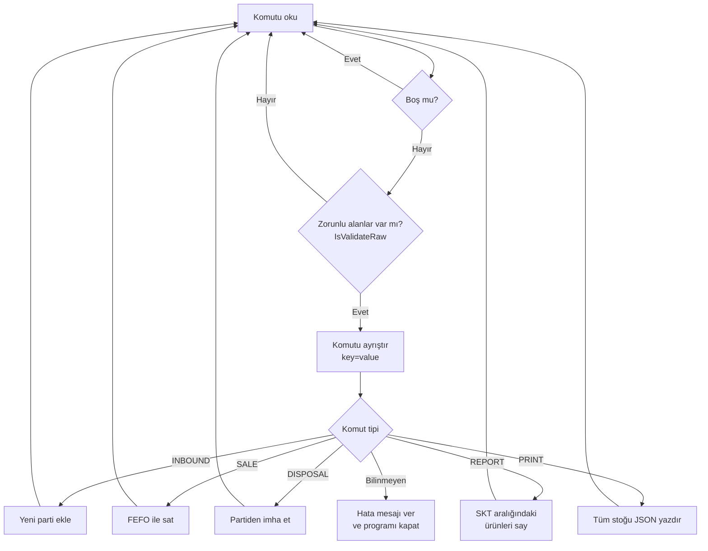

# 🛒 MarketStockTracker — Son Kullanma Tarihine Göre Stok Takibi

MarketStockTracker, bir marketin raflarındaki ürünleri **parti (batch)** bazında takip eden bir **konsol uygulamasıdır**.

Aynı ürün (örneğin süt) markete farklı günlerde, farklı son kullanma tarihleriyle gelebilir. Program bu partileri ayrı ayrı tutar ve satış yapılırken şu soruyu cevaplar:

> **"Müşteri 12 süt istiyor. Hangi partiden kaç tane vermeliyim ki son kullanma tarihi yaklaşan ürünler rafta kalıp bozulmasın?"**

Bunun için projede şu yaklaşım kullanılır:

- **FEFO (First Expired, First Out):** Son kullanma tarihi **en yakın** olan ürün **ilk** satılır.
- Son kullanma tarihleri aynıysa **FIFO (First In, First Out)** uygulanır: Markete **önce gelen** ilk satılır.

Bunlara ek olarak sistem **imha (disposal)**, **raporlama (report)** ve **stok dökümü (print)** işlemlerini de destekler.

---

## 📑 İçindekiler

- [Proje Yapısı](#-proje-yapısı)
- [Temel Kavramlar](#-temel-kavramlar)
- [Veri Modelleri](#-veri-modelleri)
- [Programın Genel Akışı](#-programın-genel-akışı)
- [Adım 1 — Komutu Okuma ve Doğrulama](#adım-1--komutu-okuma-ve-doğrulama)
- [Adım 2 — Komutu Ayrıştırma (Parsing)](#adım-2--komutu-ayrıştırma-parsing)
- [Adım 3 — Komutları Çalıştırma](#adım-3--komutları-çalıştırma)
    - [INBOUND — Stok Girişi](#-inbound--stok-girişi)
    - [SALE — FEFO ile Satış Algoritması](#-sale--fefo-ile-satış-algoritması)
    - [DISPOSAL — İmha](#️-disposal--imha)
    - [REPORT — Son Kullanma Aralığına Göre Rapor](#-report--son-kullanma-aralığına-göre-rapor)
    - [PRINT — Stok Dökümü](#️-print--stok-dökümü)
- [Baştan Sona Örnek Senaryo](#-baştan-sona-örnek-senaryo)
- [Karmaşıklık Analizi](#️-karmaşıklık-analizi)
- [Komut Referansı](#-komut-referansı)
- [Çalıştırma](#️-çalıştırma)
- [Geliştirme Notları](#-geliştirme-notları)

---

## 📁 Proje Yapısı

```
MarketStockTracker/
├── Program.cs                     # Ana döngü, komut işleme ve algoritmalar
├── Constants/
│   └── StockCommandType.cs        # Geçerli komut isimleri
└── Models/
    ├── StockBatchModel.cs         # Stoktaki bir ürün partisi
    ├── SaleModel.cs               # Satış isteği
    ├── DestroyModel.cs            # İmha isteği
    └── ReportModel.cs             # Rapor isteği
```

---

## 💡 Temel Kavramlar

### Parti (Batch) nedir?

Markete aynı anda gelen, **aynı son kullanma tarihine** sahip ürün grubuna **parti** denir. Örnek:

| Parti | Ürün | Adet | Geliş günü | Son kullanma günü |
|:---:|---|:---:|:---:|:---:|
| P1 | süt | 10 | 1 | 5 |
| P2 | süt | 8 | 2 | 3 |

Burada iki parti de "süt" ama birbirinden farklıdır. **P2 daha sonra gelmiş olmasına rağmen daha önce bozulacak.** Bu yüzden stok sadece "toplam 18 süt var" diye tutulamaz, her parti ayrı ayrı izlenmelidir.

### FIFO mu, FEFO mu?

| Yöntem | Kural | Ne zaman uygun? |
|---|---|---|
| **FIFO** — First In, First Out | İlk gelen ilk çıkar | Bozulmayan ürünler (vida, kalem, deterjan…) |
| **FEFO** — First Expired, First Out | Son kullanma tarihi en yakın olan ilk çıkar | Gıda, ilaç gibi bozulabilen ürünler |

Yukarıdaki örnekte FIFO yöntemi önce P1'i satardı ve P2 rafta bozulurdu. **FEFO yöntemi önce P2'yi satar**, böylece zarar en aza iner. Bu proje FEFO kullanır, son kullanma tarihleri eşitse FIFO'ya döner.

> 📅 Projede tarihler gerçek takvim tarihi değil, **gün numarası** (1, 2, 3 …) olarak tutulur. `stk` parametresi ürünün **son kullanma gününü** (SKT) ifade eder.

---

## 🧱 Veri Modelleri

| Model | Alanlar | Açıklama |
|---|---|---|
| `StockBatchModel` | `ProductName`, `TotalAmount`, `ExpirationDay`, `ArrivalDay` | Stoktaki bir parti. Programın **asıl verisi** budur ve hepsi `stockBatches` listesinde tutulur. |
| `SaleModel` | `ProductName`, `Amount`, `SaleDay` | Kullanıcının "şu üründen şu kadar sat" isteği. |
| `DestroyModel` | `ProductName`, `Amount`, `Day` | Kullanıcının "şu günde gelen partiden şu kadar imha et" isteği. |
| `ReportModel` | `StkStartDay`, `StkEndDay`, `ArrivalDay` | Rapor için son kullanma günü aralığı. |

`StockCommandType` sınıfı tanınan komutları sabit olarak tutar:

```
INBOUND  |  SALE  |  DISPOSAL  |  REPORT  |  PRINT
```

Program ayrıca iki durum değişkeni tutar:

```csharp
List<StockBatchModel> stockBatches;   // tüm partiler
int numberOfProductDestroyed;         // program başından beri imha edilen toplam ürün
```

---

## 🔄 Programın Genel Akışı

Program, kullanıcıdan sürekli komut alan **sonsuz bir döngüdür** (`do { ... } while (true)`).



---

### Adım 1 — Komutu Okuma ve Doğrulama

```csharp
string[] rawArray = raw.Split(" ");
string commandType = rawArray[0].Trim();
```

Satır boşluklardan bölünür. **İlk kelime komut tipidir**, geri kalanlar parametrelerdir.

```
SALE productName=sut amount=12 day=2
└┬─┘ └──────┬──────┘ └───┬───┘ └─┬─┘
komut   parametre   parametre parametre
```

Ardından `IsValidateRaw` fonksiyonu, her komut için **zorunlu alan adlarının** satırda geçip geçmediğine bakar:

| Komut | Zorunlu alanlar |
|---|---|
| `INBOUND` | `productName`, `amount`, `stk`, `day` |
| `SALE` | `productName`, `amount`, `day` |
| `REPORT` | `day`, `stkStartDay`, `stkEndDay` |
| `DISPOSAL` | `day` |
| `PRINT` | *(parametre gerekmez)* |

Eksik alan varsa kullanıcıya örnek bir komut gösterilir ve döngü başa döner.

> ⚠️ Bu kontrol `Contains` ile yapıldığı için **büyük/küçük harfe duyarlıdır**: `productName`, `stkStartDay` ve `stkEndDay` tam olarak bu şekilde (camelCase) yazılmalıdır.

---

### Adım 2 — Komutu Ayrıştırma (Parsing)

Her parametre `=` işaretinden ikiye bölünür. **Hem alan adı hem değer** küçük harfe çevrilir:

```csharp
string[] valueArray = value.Split("=");        // "amount=12" → ["amount", "12"]
string fieldName  = valueArray[0].ToLower();   // "amount"
string fieldValue = valueArray[1].ToLower();   // "12"
```

Sonra komut tipine göre ilgili model doldurulur:

| Komut | Alan adı → Model alanı |
|---|---|
| `INBOUND` | `productname` → `ProductName`, `amount` → `TotalAmount`, `stk` → `ExpirationDay`, `day` → `ArrivalDay` |
| `SALE` | `productname` → `ProductName`, `amount` → `Amount`, `day` → `SaleDay` |
| `DISPOSAL` | `productname` → `ProductName`, `amount` → `Amount`, `day` → `Day` |
| `REPORT` | `day` → `ArrivalDay`, `stkstartday` → `StkStartDay`, `stkendday` → `StkEndDay` |

Sayılar `int.TryParse` ile çevrilir. Değer sayı değilse program çökmez, alan `0` olur.

> 💡 Değerler de küçük harfe çevrildiği için `productName=SUT` yazılsa bile ürün `sut` olarak kaydedilir.

---

### Adım 3 — Komutları Çalıştırma

#### 📥 INBOUND — Stok Girişi

```csharp
stockBatches.Add(stockBatch);
```

En basit işlemdir: Gelen parti listeye **yeni bir kayıt olarak** eklenir. Aynı üründen daha önce parti olsa bile **birleştirilmez**, çünkü her partinin son kullanma tarihi ayrı takip edilmelidir.

---

#### 💰 SALE — FEFO ile Satış Algoritması

Projenin asıl algoritması burada çalışır. İki aşamadan oluşur.

##### Aşama 1: Uygun partileri bul ve sırala

```csharp
var matchingBatches = stockBatches
    .Where(x => x.ProductName.Equals(saleModel.ProductName, StringComparison.OrdinalIgnoreCase)
             && x.TotalAmount > 0)
    .OrderBy(x => x.ExpirationDay)     // 1. kural: SKT en yakın olan önce  (FEFO)
    .ThenBy(x => x.ArrivalDay);        // 2. kural: SKT eşitse önce gelen önce (FIFO)
```

| Adım | Ne yapar? |
|---|---|
| `Where` | Sadece **aynı isimdeki** ve **stokta ürünü olan** partileri alır. |
| `OrderBy(ExpirationDay)` | Son kullanma günü küçük olanı başa alır. **FEFO** kuralı budur. |
| `ThenBy(ArrivalDay)` | Son kullanma günleri eşit olan partiler arasında önce geleni başa alır. **FIFO** ile eşitlik bozma (tie-breaking) yapılır. |

> 💡 `OrderBy(...).ThenBy(...)` zinciri, SQL'deki `ORDER BY ExpirationDay, ArrivalDay` ifadesinin karşılığıdır.

##### Aşama 2: Partileri sırayla tüket (Greedy)

```csharp
foreach (StockBatchModel batchModel in matchingBatches)
{
    remainingAmount = saleModel.Amount - totalAmount;   // daha kaç tane satmam lazım?

    if (remainingAmount > batchModel.TotalAmount)       // parti yetmiyor → hepsini al
    {
        totalAmount += batchModel.TotalAmount;
        batchModel.TotalAmount = 0;
    }
    else if (remainingAmount < batchModel.TotalAmount)  // parti yetiyor → gerektiği kadar al
    {
        totalAmount += remainingAmount;
        batchModel.TotalAmount -= remainingAmount;
    }
}
```

Her partide şu soru sorulur: **"Kalan ihtiyacım bu partideki üründen fazla mı?"**

- **Fazlaysa:** Partinin tamamı satılır ve parti sıfırlanır. Bir sonraki partiye geçilir.
- **Azsa:** Partiden sadece kalan ihtiyaç kadar alınır. Satış tamamlanmış olur.

Bu bir **açgözlü (greedy)** yaklaşımdır: Sıralı listede her zaman en öndeki partiden olabildiğince fazla alınır.

##### Sonuç

```csharp
Console.WriteLine($"SALE Product={...}, Sold Out={totalAmount}, Out of Stock={saleModel.Amount - totalAmount}");
```

- **Sold Out:** Gerçekten satılabilen adet
- **Out of Stock:** Stok yetmediği için karşılanamayan adet

##### 🔍 Örnek İzleme

Stokta şu süt partileri olsun:

| Parti | Adet | Geliş günü | SKT |
|:---:|:---:|:---:|:---:|
| P1 | 10 | 1 | 5 |
| P2 | 8 | 2 | 3 |
| P3 | 6 | 3 | 5 |

**FEFO sıralaması:** P2 (SKT 3) → P1 (SKT 5, geliş 1) → P3 (SKT 5, geliş 3)

P1 ile P3'ün son kullanma günü eşit olduğu için, **önce gelen P1** öne geçer.

Komut: `SALE productName=sut amount=12 day=2`

| Sıra | Parti (adet) | Kalan ihtiyaç | Karar | Satılan toplam | Parti sonrası |
|:---:|:---:|:---:|---|:---:|:---:|
| 1 | P2 (8) | 12 | 12 > 8 → **hepsini al** | 8 | P2 = 0 |
| 2 | P1 (10) | 4 | 4 < 10 → **4 tane al** | 12 | P1 = 6 |
| 3 | P3 (6) | 0 | 0 < 6 → 0 al (satış zaten tamamlandı) | 12 | P3 = 6 |

**Çıktı:**

```
SALE Product=sut, Sold Out=12, Out of Stock=0
```

---

#### 🗑️ DISPOSAL — İmha

Bozulan veya hasarlı ürünlerin stoktan düşülmesini sağlar.

```csharp
StockBatchModel batch = stockBatches.SingleOrDefault(x =>
    x.ProductName.Contains(destroyModel.ProductName) && x.ArrivalDay == destroyModel.Day);
```

1. **Partiyi bul:** Ürün adı eşleşen **ve** belirtilen günde gelmiş **tek** partiyi arar. Bulamazsa `Not Found Product, try again!` yazar.
2. **İmha et:**
    - İstenen miktar partideki üründen fazlaysa, partinin **tamamı** imha edilir.
    - Değilse sadece **istenen kadar** imha edilir.
3. **Sayacı güncelle:** İmha edilen miktar `numberOfProductDestroyed` değişkenine eklenir.

```
DISPOSAL Total=<program başından beri imha edilen toplam adet>
```

> 💡 `Total`, sadece bu imhayı değil, program açıldığından beri yapılan **tüm imhaların toplamını** gösterir. Bu tür değişkenlere **birikimli sayaç (accumulator)** denir.

---

#### 📊 REPORT — Son Kullanma Aralığına Göre Rapor

```csharp
int reportCount = stockBatches
    .Where(x => x.ExpirationDay >= reportModel.StkStartDay && x.ExpirationDay <= reportModel.StkEndDay)
    .Sum(x => x.TotalAmount);
```

Son kullanma günü `[stkStartDay, stkEndDay]` aralığında olan (iki uç da dahil) **tüm partilerdeki** ürünlerin toplam adedini verir. Ürün adına bakılmaz.

**Kullanım örneği:** "Önümüzdeki 3 gün içinde bozulacak kaç ürünüm var?" sorusu için `stkStartDay=bugün stkEndDay=bugün+3` girilir. Böylece indirime sokulacak ürünler belirlenebilir.

```
REPORT: Total Product Amount=<adet>
```

---

#### 🖨️ PRINT — Stok Dökümü

```csharp
Console.WriteLine(JsonSerializer.Serialize(stockBatches, new JsonSerializerOptions { WriteIndented = true }));
```

Tüm partileri, okunabilir (girintili) **JSON** formatında ekrana yazdırır. Satılıp sıfırlanmış partiler de listede görünmeye devam eder. Hata ayıklarken stoğun anlık durumunu görmek için kullanışlıdır.

---

## 🎬 Baştan Sona Örnek Senaryo

### 1. Stok girişi

```
INBOUND productName=sut amount=10 stk=5 day=1
INBOUND productName=sut amount=8 stk=3 day=2
INBOUND productName=sut amount=6 stk=5 day=3
INBOUND productName=ekmek amount=20 stk=2 day=1
```

| Parti | Ürün | Adet | Geliş | SKT |
|:---:|---|:---:|:---:|:---:|
| P1 | sut | 10 | 1 | 5 |
| P2 | sut | 8 | 2 | 3 |
| P3 | sut | 6 | 3 | 5 |
| P4 | ekmek | 20 | 1 | 2 |

### 2. Yakında bozulacaklar raporu

```
REPORT day=1 stkStartDay=1 stkEndDay=3
```

SKT'si 1 ile 3 arasında olan partiler P2 (8) ve P4 (20).

```
REPORT: Total Product Amount=28
```

### 3. Satış

```
SALE productName=sut amount=12 day=2
```

Yukarıdaki örnek izlemede gösterildiği gibi P2'nin tamamı ve P1'den 4 tane satılır.

```
SALE Product=sut, Sold Out=12, Out of Stock=0
```

### 4. İmha

```
DISPOSAL productName=ekmek amount=5 day=1
```

P4'ten 5 ekmek imha edilir, P4'te 15 ekmek kalır.

```
DISPOSAL Total=5
```

```
DISPOSAL productName=ekmek amount=50 day=1
```

İstenen 50, partide kalan 15'ten fazla olduğu için kalan 15 ekmeğin tamamı imha edilir. Birikimli toplam 5 + 15 = 20 olur.

```
DISPOSAL Total=20
```

### 5. Güncel durum raporu

```
REPORT day=1 stkStartDay=1 stkEndDay=5
```

Tüm partiler bu aralıkta: P1 (6) + P2 (0) + P3 (6) + P4 (0) = **12**

```
REPORT: Total Product Amount=12
```

### 6. Döküm

```
PRINT
```

```json
[
  {
    "ArrivalDay": 1,
    "TotalAmount": 6,
    "ExpirationDay": 5,
    "ProductName": "sut"
  },
  {
    "ArrivalDay": 2,
    "TotalAmount": 0,
    "ExpirationDay": 3,
    "ProductName": "sut"
  },
  {
    "ArrivalDay": 3,
    "TotalAmount": 6,
    "ExpirationDay": 5,
    "ProductName": "sut"
  },
  {
    "ArrivalDay": 1,
    "TotalAmount": 0,
    "ExpirationDay": 2,
    "ProductName": "ekmek"
  }
]
```

---

## ⏱️ Karmaşıklık Analizi

**n** = toplam parti sayısı, **k** = satılan ürüne ait parti sayısı.

| Komut | Zaman | Açıklama |
|---|---|---|
| `INBOUND` | `O(1)` | Listenin sonuna ekleme |
| `SALE` | `O(n + k log k)` | Tüm listede filtreleme `O(n)` + eşleşen partileri sıralama `O(k log k)` |
| `DISPOSAL` | `O(n)` | `SingleOrDefault` tüm listeyi tarar |
| `REPORT` | `O(n)` | Filtreleme ve toplama |
| `PRINT` | `O(n)` | Her partiyi JSON'a çevirme |

Stok büyüdükçe şu iyileştirmeler yapılabilir:

- **Ürün bazlı sözlük (`Dictionary<string, List<StockBatchModel>>`):** Satışta tüm listeyi taramadan sadece o ürünün partilerine bakılır.
- **Öncelik kuyruğu (`PriorityQueue`):** Partiler `(ExpirationDay, ArrivalDay)` önceliğiyle tutulursa her satışta yeniden sıralama gerekmez.
- **Erken çıkış:** Satış tamamlandığında (`remainingAmount == 0`) döngüden `break` ile çıkılabilir.
- **Boş partileri temizleme:** Adedi 0'a düşen partiler listeden silinerek liste küçük tutulabilir.

---

## 📋 Komut Referansı

| Komut | Söz dizimi | Örnek |
|---|---|---|
| Stok girişi | `INBOUND productName=<ad> amount=<adet> stk=<SKT günü> day=<geliş günü>` | `INBOUND productName=sut amount=10 stk=5 day=1` |
| Satış | `SALE productName=<ad> amount=<adet> day=<gün>` | `SALE productName=sut amount=12 day=2` |
| İmha | `DISPOSAL productName=<ad> amount=<adet> day=<geliş günü>` | `DISPOSAL productName=ekmek amount=5 day=1` |
| Rapor | `REPORT day=<gün> stkStartDay=<başlangıç> stkEndDay=<bitiş>` | `REPORT day=1 stkStartDay=1 stkEndDay=3` |
| Döküm | `PRINT` | `PRINT` |

**Kurallar:**

- Komut adı **BÜYÜK HARF** yazılmalıdır.
- `productName`, `stkStartDay` ve `stkEndDay` alan adları **tam bu yazımla** (camelCase) girilmelidir.
- Parametreler `anahtar=değer` biçiminde, aralarında **tek boşlukla** yazılmalıdır.
- ⚠️ **Tanınmayan bir komut girilirse program kapanır.**

---

## ▶️ Çalıştırma

**Gereksinimler:** .NET 6 veya üzeri. Ek bir NuGet paketi gerekmez, `System.Text.Json` .NET ile birlikte gelir.

```bash
dotnet run
```

Program açılınca `Please, Enter value:` yazısı görünür ve komut beklemeye başlar.

---

## 📝 Geliştirme Notları

Koda dokunulmadan yapılan incelemede bazı davranışlar göze çarptı. Bunlar ileride geliştirme yaparken bakılabilecek noktalardır:

1. **Satışta eşitlik durumu:** Kalan ihtiyaç partideki adede **tam eşitse** (`remainingAmount == batchModel.TotalAmount`), ne `>` ne de `<` koşulu sağlanır ve o partiden hiç ürün alınmaz. Örneğin stokta 6 süt varken `SALE productName=sut amount=6 day=1` komutu `Sold Out=0, Out of Stock=6` sonucunu verir. Koşullardan biri `>=` veya `<=` yapılırsa bu durum çözülür.
2. **Satış günü kullanılmıyor:** `SaleDay` okunuyor ama hesaba katılmıyor. Bu yüzden son kullanma günü geçmiş partiler (`ExpirationDay < SaleDay`) ve henüz gelmemiş partiler (`ArrivalDay > SaleDay`) de satılabiliyor.
3. **İmhada parti arama:**
    - `Contains` kullanıldığı için ürün adı **kısmi** eşleşiyor. Örneğin `su` yazıldığında hem `sut` hem `sucuk` bulunur.
    - Aynı gün gelmiş birden fazla eşleşen parti varsa `SingleOrDefault` hata fırlatır ve program çöker.
    - Doğrulama sadece `day` alanını zorunlu tutuyor. `productName` girilmezse `Contains(null)` çağrısı hata fırlatır.
4. **Bilinmeyen komut programı kapatıyor:** `switch` yapısındaki `default` dalında `continue` yerine `return` var. Ayrıca bu hata mesajında `PRINT` komutu listelenmiyor. Doğrulama hata mesajı da her durumda sadece `INBOUND` örneğini gösteriyor.
5. **Harf duyarlılığı tutarsız:** Doğrulama (`IsValidateRaw`) alan adlarında büyük/küçük harfe duyarlı, ayrıştırma (`ToLower`) ise duyarsız çalışıyor. `productname=sut` ayrıştırmada doğru okunurdu ama doğrulamadan geçemiyor.
6. **Kullanılmayan alanlar:** `REPORT` komutundaki `day` (`ReportModel.ArrivalDay`) ve `SaleModel.SaleDay` okunuyor ama hiçbir hesapta kullanılmıyor.

---

## 🎓 Bu Projede Öğrenilen Kavramlar

- Stoğu **parti (batch / lot)** bazında takip etmek
- **FEFO** ve **FIFO** stok yönetimi stratejileri ve aralarındaki fark
- `OrderBy` + `ThenBy` ile **çok kriterli sıralama** ve **eşitlik bozma (tie-breaking)**
- **Greedy** yaklaşımla bir talebi sıralı kaynaklardan karşılamak
- **Birikimli sayaç (accumulator)** ile toplam değer tutmak
- LINQ ile **aralık filtreleme** (`Where`) ve **toplama** (`Sum`)
- `System.Text.Json` ile nesneleri **JSON'a serileştirmek**
- Konsoldan gelen metni `Split` ile **ayrıştırmak (parsing)**